# 🛡️ The Daml & Canton Security Handbook
### From Solidity Auditor to Canton Auditor: A Self-Contained Study Book

> **Who this is for:** a smart contract auditor who already knows Solidity/EVM (and maybe Rust) and wants to audit **Daml smart contracts on the Canton Network**.
> **How to read it:** front to back, once. Do every 🧪 **Lab**. Every 🔍 **Audit Question** goes into your personal checklist.
> **Version note:** written against **Daml 3.x / Canton 3.x** (SDK 3.4–3.5 era, late 2026). Daml changes between major versions, so check the official docs whenever syntax matters.

> 💡 **Rendering tip:** diagrams use **Mermaid**. Open this file on GitHub, in VS Code (with a Mermaid preview extension), or in Obsidian to see them drawn.

---

## 📚 Table of Contents

**Part I: Foundations**
1. [Why Canton Exists (and Why It Needs Auditors)](#1-why-canton-exists)
2. [Canton Architecture in 15 Minutes](#2-canton-architecture)
3. [Daml for Solidity Developers](#3-daml-for-solidity-developers)
4. [The Ledger Model: Authorization & Privacy, Formally](#4-the-ledger-model)

**Part II: The Attack Surface**

5. [The Mental Model Shift: What Disappears, What Remains](#5-the-mental-model-shift)
6. [The Vulnerability Catalogue (18 bug classes)](#6-the-vulnerability-catalogue)

**Part III: Canton Network Specifics**

7. [Splice, Amulet & Canton Coin](#7-splice-amulet--canton-coin)
8. [The Token Standard (CIP-56 / CIP-0112)](#8-the-token-standard)

**Part IV: Doing the Audit**

9. [Audit Methodology](#9-audit-methodology)
10. [Case Studies from Real Audits](#10-case-studies)
11. [The Master Checklist](#11-the-master-checklist)
12. [Hands-On Labs](#12-hands-on-labs)
13. [6-Week Study Plan, Resources & Glossary](#13-study-plan-resources--glossary)

---

# PART I: FOUNDATIONS

---

## 1. Why Canton Exists

### 1.1 The problem: banks can't use a public ledger

Picture Goldman Sachs doing a $500M repo trade with a pension fund on Ethereum. Every validator, MEV searcher and competitor sees the counterparty, the size, the price and the collateral. **That is a non-starter for regulated finance.**

The opposite extreme is a private chain per consortium. Then every network becomes a silo: a bond on Bank A's chain can't atomically settle against cash on Bank B's chain.

**Canton's answer:** *one logical network of many privately hosted ledgers*. Each party sees **only the parts of a transaction it is entitled to see**, yet transactions can still be **atomic across organizations**.

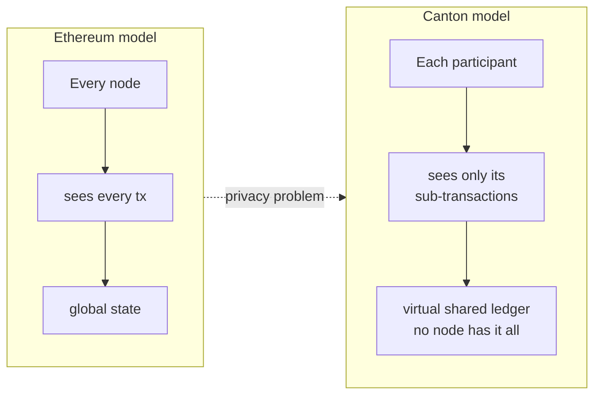

### 1.2 The real world today

Canton is not a testnet toy. Production workloads include real-time, on-chain financing of U.S. Treasuries (Tradeweb, against USDC), tokenized collateral and repo, institutional stablecoins (USDCx via the Digital Asset Registry) and wallet/DvP flows on the **Global Synchronizer**. Large financial-market infrastructures (DTCC, Euroclear and others) take part in governance or pilots.

**Why this matters to you:** the assets are huge, the bug classes are novel, and in 2025–26 there were **very few Daml-literate auditors**. Firms like Halborn, CertiK, Quantstamp, OpenZeppelin, Hacken and QuillAudits all started Daml practices around then. **Being early in a niche is the classic way to stand out.**

### 1.3 IRL analogy: the notary office

Think of Canton as a **network of notary offices**:

- Each **party** (Alice, BankA) has a notary (a **participant node**) that keeps *their* copy of every contract they're on.
- A **courier service** (the **synchronizer**) carries sealed envelopes between notaries and stamps them with a time and order. It **cannot read the envelopes.**
- A **contract** is a signed paper. Changing it means **tearing it up and signing a new one** (archive + create).
- **Daml** is the legal language contracts are written in. It is so strict that a contract literally cannot be created unless every required person has signed.

Keep this picture in mind. Most Daml bugs translate to *"someone got a blank signed cheque"* or *"someone saw a document they shouldn't have."*

---

## 2. Canton Architecture

### 2.1 The cast of characters

| Component | What it does | EVM analogy (rough) |
|---|---|---|
| **Party** | A legal identity (Alice, BankA). Has a key. Acts on the ledger. | EOA / address |
| **Participant node** | Hosts parties. Stores *their* contracts. Runs Daml, validates transactions. Exposes the **Ledger API**. | Your own full node, but storing only *your* state |
| **Synchronizer** (formerly "domain") | Orders and delivers encrypted messages. Made of a **sequencer** and a **mediator**. | Consensus layer, but blind to contents |
| **Sequencer** | Totally orders encrypted messages and assigns record time. | Block producer that can't read txs |
| **Mediator** | Collects confirmations and announces commit/abort. | Commit coordinator |
| **Global Synchronizer** | The public, decentralized synchronizer run by **Super Validators** (BFT). | "Mainnet" |
| **Validator** | A participant node connected to the Global Synchronizer. | Node operator |
| **DSO party** | The *Decentralized Synchronizer Operator*: a party jointly controlled by the Super Validators. Administers Canton Coin. | Protocol multisig / governance |
| **PQS** | *Participant Query Store*: an off-ledger SQL mirror of a participant's contracts. | The Graph / indexer |
| **DAR** | A compiled Daml package (Daml Archive). | Deployed bytecode |

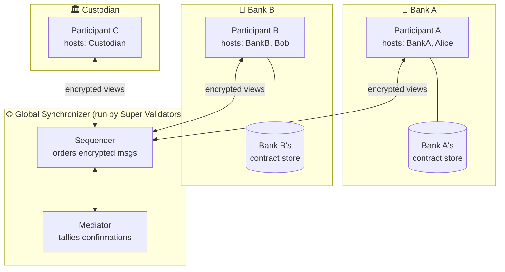

### 2.2 How a transaction commits (the two-phase protocol)

This is **the** diagram to understand. A Canton transaction is **not** broadcast. It is split into **views**, and each participant gets only the views involving its parties.

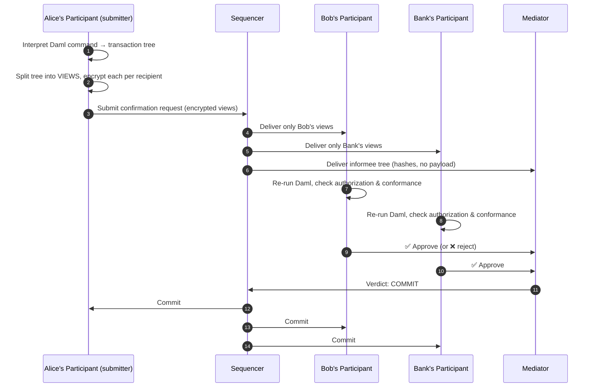

**Security takeaways:**
1. **Each confirming participant re-executes the Daml.** A malicious submitter can't lie about what the code does: honest participants would reject.
2. **Authorization is checked by the protocol.** If a `create` needs Bob's signature and Bob's participant didn't authorize it, it fails. *No amount of API manipulation bypasses it.*
3. **Privacy is per-view.** The sequencer and mediator never see payloads.
4. **The protocol guarantees only what the Daml model says.** If your template *gives away* authority, the protocol faithfully enforces the giveaway. **This is where auditors earn their money.**

### 2.3 Trust assumptions to keep in mind

| You trust… | …for | If it's malicious/compromised |
|---|---|---|
| Your own participant | Executing honestly on your behalf, holding your keys | It can act **as you** (sign anything your parties can sign) |
| The synchronizer | Liveness and ordering | Can censor/delay, but can't forge or read |
| Counterparties' participants | Nothing beyond their own parties' authority | Can refuse to confirm (liveness), can't forge your authority |
| The Daml model | **Everything about business rules** | Whatever the model allows, the network will enforce |

> 🔍 **Audit Question:** *"If party X's participant is fully malicious, what can X do that the business doesn't intend?"* Ask it for every party in the model.

---

## 3. Daml for Solidity Developers

### 3.1 The Rosetta Stone

| Solidity / EVM | Daml | Note |
|---|---|---|
| `contract` (code + mutable storage) | **`template`** (code) + **contract instances** (immutable data) | Templates are like classes. Contracts are immutable instances. |
| storage write `x = 5` | **archive old contract, create new one** | UTXO-style. Nothing ever mutates. |
| `function` | **`choice`** | An action on a contract instance |
| `msg.sender` checks / `onlyOwner` | **`controller`** | Declared, enforced by the protocol |
| *(no equivalent)* | **`signatory`** | Parties whose authority is **required to create** and **bound by** the contract |
| everything public | **`observer`** | Who may *see* the contract |
| `require(...)` | **`assertMsg` / `ensure`** | `ensure` = invariant checked at creation |
| `mapping` lookup | `fetch cid` (by contract ID) / contract keys (non-unique in 3.5+) | No global storage scan on-ledger |
| events | the transaction tree itself (creates/archives are the events) | |
| `uint256` overflow | `Int` is 64-bit and **aborts on overflow** | No silent wraparound |
| fixed-point libs | `Decimal` (= `Numeric 10`), `Numeric n` | Rounding still matters! |
| reentrancy | **Not possible** (no callbacks, pure functional, atomic tree) | |
| `block.timestamp` | `getTime` (ledger time) | **Submitter-influenced within a tolerance!** |
| Foundry tests | **Daml Script** | `submit`, `submitMustFail` |
| proxy upgrade | **Smart Contract Upgrade (SCU)** | New package versions, compatibility rules |
| `revert` | `abort` / failed assertion → whole tx fails | Exceptions are deprecated in 3.x |

### 3.2 Your first template, annotated

```haskell
module Iou where

-- A template is the "class". Each `create` makes an immutable contract instance.
template Iou
  with
    issuer   : Party      -- the bank that owes money
    owner    : Party      -- who is owed
    amount   : Decimal
    currency : Text
  where
    -- SIGNATORIES: must ALL authorize creation, are bound by the contract,
    -- always see it, and are the only ones who can archive it (by default).
    signatory issuer, owner

    -- ENSURE: invariant checked on create. Violations abort the transaction.
    ensure amount > 0.0

    -- A CONSUMING choice (the default): exercising it ARCHIVES this contract.
    choice Transfer : ContractId IouTransferProposal
      with
        newOwner : Party
      controller owner           -- only `owner` can exercise
      do
        -- The body runs with the authority of: controllers + signatories.
        -- So here we hold {owner, issuer}'s authority.
        create IouTransferProposal with iou = this; newOwner

    -- A NONCONSUMING choice: contract stays alive. (Danger zone, see §6.)
    nonconsuming choice GetAmount : Decimal
      with
        reader : Party
      controller reader          -- "flexible controller": chosen by the caller
      do
        assertMsg "only stakeholders" (reader == owner || reader == issuer)
        pure amount

template IouTransferProposal
  with
    iou      : Iou
    newOwner : Party
  where
    signatory iou.issuer, iou.owner
    observer  newOwner           -- newOwner must SEE it to accept

    choice Accept : ContractId Iou
      controller newOwner
      do
        -- Authority here = {newOwner} + signatories {issuer, owner}
        -- = enough to create an Iou signed by issuer & newOwner ✅
        create iou with owner = newOwner

    choice Withdraw : ContractId Iou
      controller iou.owner
      do create iou
```

### 3.3 Choice flavours: know them cold

| Keyword | Effect on the contract | Typical bug |
|---|---|---|
| `choice` (consuming) | Archived **before** the body runs | Forgetting to recreate it with all fields |
| `nonconsuming choice` | Stays active | **Repeatable**: can be exercised again and again |
| `preconsuming choice` | Archived **before** the body (explicit) | Same as consuming |
| `postconsuming choice` | Archived **after** the body | Body may observe or fetch itself |

> ⚠️ **Mantra:** *every `nonconsuming` choice is a loop the attacker controls.* Ask what happens if it's called 1,000 times.

### 3.4 Testing with Daml Script (your Foundry)

```haskell
import Daml.Script

test_transfer : Script ()
test_transfer = script do
  bank  <- allocateParty "Bank"
  alice <- allocateParty "Alice"
  bob   <- allocateParty "Bob"
  eve   <- allocateParty "Eve"

  -- Creating an Iou needs BOTH bank and alice → submit with both
  iou <- submitMulti [bank, alice] [] do
    createCmd Iou with issuer = bank; owner = alice; amount = 100.0; currency = "USD"

  prop <- submit alice do exerciseCmd iou Transfer with newOwner = bob

  -- ❌ Eve can't accept Bob's proposal (not the controller)
  submitMustFail eve do exerciseCmd prop Accept

  -- ✅ Bob can
  _ <- submit bob do exerciseCmd prop Accept
  pure ()
```

> 🧪 **Habit:** for every finding you suspect, write a `Script` that proves it. A Daml PoC is a script where the attacker's `submit` **succeeds** when it should fail.

### 3.5 Interfaces

Interfaces let many templates share choices (the token standard is built entirely on them).

```haskell
interface Holding where
  viewtype HoldingView
  getOwner : Party

  choice Holding_Transfer : ContractId Holding
    with newOwner : Party
    controller getOwner this
    do transferImpl this newOwner

  transferImpl : Party -> Update (ContractId Holding)
```

> 🔍 **Key insight (CertiK, on CIP-56):** *interfaces fix argument shapes, controllers and observers, but they don't enforce business rules.* If the spec says an implementation "MUST validate X", the **ledger does not check that for you**. Audit every `implements` block.

---

## 4. The Ledger Model

This chapter is the theory that every Daml finding reduces to. Learn it once and you can reason about any model.

### 4.1 Actions

There are only a few ledger actions:

| Action | Meaning | Required authorizers |
|---|---|---|
| **Create** | Bring a contract into existence | **All signatories** |
| **Exercise** | Run a choice on a contract | **All controllers** of the choice |
| **Fetch** | Read an active contract inside a transaction | At least one **stakeholder** (signatory or observer) |
| **Archive** | A consuming exercise | (as Exercise) |

A transaction is a **tree**: an exercise has **consequences** (child actions).

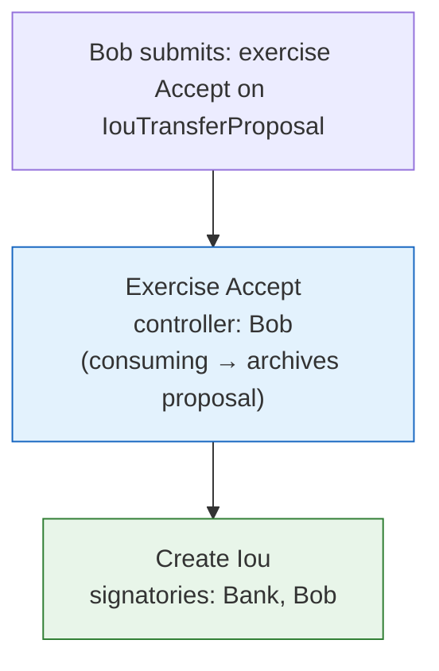

### 4.2 The authorization rule (the most important rule in this book)

> **The consequences of an exercise are authorized by the exercise's controllers (actors) plus the signatories of the contract being exercised.**

So when a signatory signs a contract, **they pre-authorize everything every choice on it can ever do.** A template is a *standing power of attorney* from its signatories to its controllers, limited only by the code of the choices.

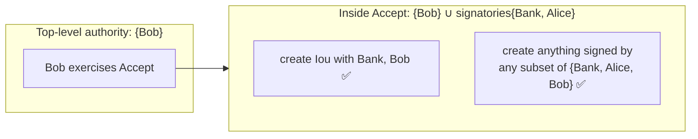

**IRL analogy:** a signatory is like a CEO signing a **pre-signed corporate cheque book** and handing it to a controller. The choice body says what may be written on the cheques. If the body says "amount: whatever the controller types", you have a **blank cheque**.

#### Corollaries an auditor must internalize

1. **Authority does not leak upward or sideways automatically.** Authority from an outer exercise is **not** carried into a nested exercise on a *different* contract. Inside the nested choice, the context is reset to *that* contract's signatories + controllers. (This is why delegation works safely and why "it worked in the outer call" is not a proof.)
2. **The authority available in a choice body is fully determined by the template.** It doesn't depend on who called it. That makes it *statically auditable*: for each choice, write down `controllers ∪ signatories`. That set is the maximum damage.
3. **Controllers prove *who* authorized, not that the arguments are right.** A choice controlled by Alice with an argument `amount : Decimal` lets Alice pick *any* amount unless the body validates it.

### 4.3 Who sees what: privacy rules

**Stakeholders** = signatories ∪ observers.

| Party role | Sees create? | Sees consuming exercise? | Sees nonconsuming exercise / fetch? |
|---|---|---|---|
| Signatory | ✅ | ✅ | ✅ |
| Contract observer | ✅ | ✅ | ❌ (unless also actor or choice observer) |
| Actor (controller) of an exercise | n/a | ✅ that exercise + its subtree | ✅ |
| Choice observer | n/a | ✅ that exercise + its subtree | ✅ |

Plus the **sub-transaction privacy** rule: if you see an exercise, you see **its whole subtree**, i.e. everything it creates, fetches and exercises.

### 4.4 Divulgence vs explicit disclosure

Hacken's privacy-audit write-up separates "who can see this?" into three different questions. Each has different rights, lifetimes and leak paths:

| Mechanism | How you learn of the contract | Can you *use* it later? | Do you learn of later events? |
|---|---|---|---|
| **Stakeholder** | You're a signatory or observer | ✅ | ✅ |
| **Divulgence** | You witnessed a transaction that **fetched/exercised** it (sub-tx privacy) | ❌ (view only, in Canton 3) | ❌ |
| **Explicit disclosure** | Someone handed you the **contract blob off-ledger** and you attach it to your command | ✅ (while active) | ❌ |

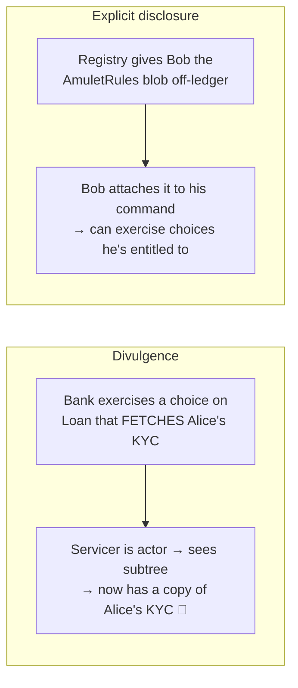

**IRL example of divulgence:** your accountant forwards you an email thread to ask one question, and you can read every older message in the thread. Nobody "shared" those messages with you on purpose. They came along with the subtree.

> 🔍 **Audit Questions:**
> - Does any choice `fetch` data (KYC, prices, positions) that its **actor** shouldn't see?
> - Are **observers** on a contract broader than "needs to know"?
> - Are there **choice observers** that see a whole subtree?
> - Removing an observer requires **archive + recreate**. Is there a path for that, and does revoking a delegation *also* remove earlier visibility? (It can't: data already seen stays seen.)

### 4.5 Contract keys in Canton 3

- In Daml 2.x, keys were **unique** and gave on-ledger uniqueness guarantees.
- Daml 3.0–3.4: **no contract keys at all.** Fetch by contract ID only.
- **Canton 3.5 (May 2026)** reintroduced keys with two big differences: **keys are not unique** (several contracts can share one) and **negative lookups are not validated**.

> ⚠️ **Security consequence:** *you cannot rely on the ledger to prevent duplicates.* "There can only be one pool per pair", "one account per user" and "one config contract" must be enforced by **design** (e.g. a single factory contract that is consumed and recreated, or an operator-signed registry), and auditors must check it. Halborn's Tradecraft audit had exactly this finding (HAL-04, *multiple liquidity pools can be created for the same instrument pair*).

### 4.6 Time on the ledger

- `getTime` returns **ledger time**, which the **submitter proposes**. Canton accepts it if it's within a tolerance of the sequencer's **record time** (a configurable skew window, often about a minute).
- Ordering of events across **different synchronizers** isn't guaranteed.
- So: **time checks are fuzzy by up to the tolerance**, and **the submitter picks where in the window they land.**

**IRL analogy:** a bank lets you write the date on your own cheque as long as it's within a day of when it's cashed. If the deadline is "before Friday", you can date it Friday 23:59 even though you're cashing it Saturday 00:30.

> 🔍 **Audit Questions:** Is a deadline enforced **in both directions** (no early withdraw *and* no late settle)? Could an attacker profit from shifting time by the tolerance? Newer SDKs ship time-bound helpers in `DA.Time` (e.g. `isLedgerTimeLT`, `assertWithinDeadline`) that constrain ledger time instead of reading a point value. Check whether the code uses them correctly.

---

# PART II: THE ATTACK SURFACE

---

## 5. The Mental Model Shift

### 5.1 What disappears

| EVM bug class | Daml status | Why |
|---|---|---|
| Reentrancy | ❌ Gone | No callbacks, no external calls into arbitrary code mid-update |
| Integer overflow/underflow | ❌ Gone (as silent bug) | `Int` aborts on overflow → becomes a **DoS** question instead |
| `tx.origin` phishing | ❌ Gone | No tx.origin. Authorization is declared |
| Storage collision / delegatecall | ❌ Gone | No shared mutable storage |
| Front-running / MEV (public mempool) | 🔶 Mostly gone | Payloads encrypted, but *your own participant / sequencer operator* still sees metadata and timing |
| Signature replay | 🔶 Different form | Shows up as **reusable authorization contracts** and nonconsuming choices |
| Unchecked call return | ❌ Gone | Any failure aborts the whole atomic tree |

### 5.2 What remains (and what's new)

OpenZeppelin, after building the first adversarial Daml tooling, reported these as the bug classes that matter: **conservation violations**, **arithmetic faults from governance-controlled parameters**, **temporal assumptions in settlement logic**, and **non-deterministic ordering at the application boundary**. Add to those the **authorization**, **privacy** and **lifecycle** issues documented by Hacken, CertiK and Halborn.

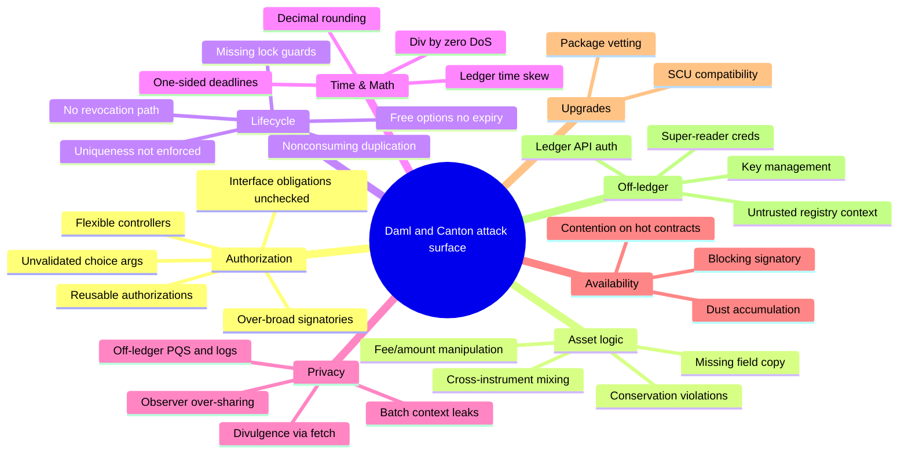

### 5.3 The auditor's three questions

For **every** template and choice, ask:

1. 🔐 **Authority:** *Who can make this happen, and with whose signatures?*
2. 👁️ **Visibility:** *Who learns what because this happened?*
3. ♻️ **Lifecycle:** *Can it be done twice, too early, too late, never undone, or blocked forever?*

---

## 6. The Vulnerability Catalogue

> **Format of each entry:** 🏠 IRL analogy → ❌ vulnerable code → ✅ fix → 🔍 audit question.
> Code is **illustrative** (written to teach the pattern, simplified, not copied from any audited codebase).

---

### V1. Unvalidated Contract-ID Arguments ("Bring Your Own Contract")
**Severity potential: Critical** · Real-world twin: Halborn Tradecraft **HAL-01** *(LP token supply can be created or consumed from a different pool)*

🏠 **IRL:** a cloakroom that accepts *any* ticket stub and hands over whatever coat matches the number, even a stub from the cloakroom across the street.

A choice takes `ContractId X` as an argument and `fetch`es it, but never checks that the fetched contract **belongs to this context** (same pool, same issuer, same owner, same instrument).

```haskell
-- ❌ VULNERABLE
template Pool
  with
    operator : Party
    poolId   : Text
    reserveA : Decimal
  where
    signatory operator

    nonconsuming choice Redeem : ()
      with
        user  : Party
        lpCid : ContractId LpToken
      controller user
      do
        lp <- fetch lpCid
        -- 🚨 never checks lp.poolId == poolId or lp.owner == user
        archive lpCid
        payOut user (lp.amount * reserveA)
```

```haskell
-- ✅ FIXED
        lp <- fetch lpCid
        assertMsg "wrong pool"  (lp.poolId == poolId)
        assertMsg "wrong admin" (lp.operator == operator)
        assertMsg "not owner"   (lp.owner == user)
```

Hacken describes the same bug in its **Authorization** pattern: passing an authorization contract ID without checking its `bank` and `party` fields means *any valid authorization unlocks any transfer*.

> 🔍 **For every `fetch` / `exercise` on an argument CID:** which fields are checked against `this`? Issuer? Owner? Instrument? Pool? Settlement ID? **Every missing field is a candidate finding.** Interface fetches (`fetch @Holding`) need extra care: the concrete template could be anything implementing the interface, so check its `admin`/`instrumentId`.

---

### V2. Caller-Controlled Economic Parameters
**Severity potential: Critical** · Real-world twin: Halborn **HAL-02** *(user controlled transfer fee parameter enables unauthorized token overpayment)*

🏠 **IRL:** a vending machine that asks *you* to type in the price.

```haskell
-- ❌ VULNERABLE: fee comes from the choice argument
choice Swap : ContractId Holding
  with
    trader  : Party
    input   : ContractId Holding
    feeRate : Decimal          -- 🚨 attacker sets 0.0, or a value that drains someone else
  controller trader
  do ...
```

```haskell
-- ✅ FIXED: fee comes from an operator-signed config contract, validated by issuer
choice Swap : ContractId Holding
  with
    trader    : Party
    input     : ContractId Holding
    configCid : ContractId FeeConfig
  controller trader
  do
    cfg <- fetch configCid
    assertMsg "config admin" (cfg.operator == operator)
    let feeRate = cfg.feeRate
    ...
```

> 🔍 List **every choice argument** of type `Decimal`, `Int`, `Party`, `Time`, `ContractId`. For each, ask: *"What if the controller lies?"* Controllers prove **who**, not **what**.

---

### V3. Conservation Violations
**Severity potential: Critical/High** · Flagged by OpenZeppelin as a top Daml bug class

🏠 **IRL:** a currency exchange booth where, if you ask for change in three envelopes instead of two, the total comes out a little bigger.

Because state is UTXO-like, **every** transfer/split/merge path must satisfy `Σ inputs = Σ outputs (+ fees)`. Bugs hide in rarely used paths: partial fills, multi-leg settlement, rounding remainders, fee splits, merges across different instruments.

```haskell
-- ❌ VULNERABLE Split
choice Split : (ContractId Coin, ContractId Coin)
  with splitAmount : Decimal
  controller owner
  do
    a <- create this with amount = splitAmount
    b <- create this with amount = amount       -- 🚨 should be amount - splitAmount
    pure (a, b)
```

```haskell
-- ❌ VULNERABLE Merge (cross-issuer)
choice Merge : ContractId Coin
  with otherCid : ContractId Coin
  controller owner
  do
    other <- fetch otherCid
    -- 🚨 no check other.issuer == issuer, other.owner == owner, other.currency == currency
    archive otherCid
    create this with amount = amount + other.amount
```

```haskell
-- ✅ FIXED
  do
    assertMsg "positive" (splitAmount > 0.0 && splitAmount < amount)
    a <- create this with amount = splitAmount
    b <- create this with amount = amount - splitAmount
    pure (a, b)
```

> 🔍 Write the conservation invariant **explicitly** and test it with property-based testing (OpenZeppelin's **daml-props**) or prove it (**daml-verify**, Z3). Check **merge**: same issuer, same owner, same instrument, same lock state?

---

### V4. Archive-and-Recreate Field Drift

🏠 **IRL:** re-typing a contract to fix one clause and accidentally leaving out the collateral paragraph.

Since state changes mean "archive + create", a choice that rebuilds a record **by hand** can silently drop or reset fields. Hacken notes that a missed field quietly produces wrong values.

```haskell
-- ❌ Rebuilding by hand: `lockedUntil` silently reset to default
create Account with owner; balance = newBalance; issuer; lockedUntil = None
-- ✅ Copy-with-update: everything else preserved
create this with balance = newBalance
```

> 🔍 Prefer `create this with field = v`. Flag any hand-rolled record construction in state-transition choices.

---

### V5. Missing Guards on Some Choices (the "one door left open")
Hacken's **Locking** pitfall: *the compiler can't verify that every state-changing choice checks `isLocked`.*

🏠 **IRL:** a bank freezes your account, but forgets that the ATM uses a different code path.

```haskell
template Asset
  with owner : Party; issuer : Party; locked : Bool; amount : Decimal
  where
    signatory issuer, owner
    choice Transfer : ContractId Asset with to : Party
      controller owner
      do assertMsg "locked" (not locked); create this with owner = to
    choice Split : (ContractId Asset, ContractId Asset) with x : Decimal
      controller owner
      do -- 🚨 no lock check → split, then transfer the fresh unlocked halves?
         -- (if Split recreates with locked = False, or if the lock lives on a separate contract)
         ...
```

> 🔍 Build a **guard matrix**: rows = choices, columns = conditions (locked? expired? paused? correct state?). Every empty cell needs a justification.

---

### V6. Free Options: Proposals with No Expiry or Withdraw
Hacken's **Propose-Accept** pitfall: *open proposals act as free options unless they have a Withdraw choice and an expiry.*

🏠 **IRL:** you send a signed offer to sell your house for $500k with no expiry date. Five years later the market's at $900k and the buyer "accepts".

```haskell
-- ❌ Proposal at a fixed price, no expiry, no withdraw
template SellOffer
  with seller : Party; buyer : Party; price : Decimal; asset : ContractId Asset
  where
    signatory seller
    observer buyer
    choice Accept : () controller buyer do ...
```

```haskell
-- ✅
    choice Accept : ()
      controller buyer
      do
        now <- getTime
        assertMsg "expired" (now < expiresAt)
        ...
    choice Withdraw : () controller seller do pure ()
```

Related: Halborn **HAL-09** *(requests and relationships cannot be explicitly revoked once created)*.

> 🔍 Every proposal/request/relationship/authorization: **who can cancel it, and when does it die?**

---

### V7. Nonconsuming Duplication & Reusable Authorizations

🏠 **IRL:** a "one free coffee" voucher the barista stamps but never collects.

Hacken lists two variants: a **non-consuming parent choice** can spawn unlimited duplicate proposals, and a **reusable authorization** can enable repeated transfers (archive it on use, or add a consuming `Use` choice).

```haskell
-- ❌ The approval can be used forever
template TransferApproval
  with bank : Party; party : Party
  where
    signatory bank
    observer party
    nonconsuming choice UseApproval : () with assetCid : ContractId Asset
      controller party
      do ... -- moves an asset with bank's authority, again and again
```

> 🔍 For every `nonconsuming` choice that **creates** or **transfers** anything: is that idempotent? If not, it's a finding.

---

### V8. Over-Broad Delegation (Power of Attorney Too Wide)

🏠 **IRL:** you sign a power of attorney "for my affairs" when you meant "to sell my car".

Hacken's **Delegation** pitfalls: the PoA covers *any agreement the attorney can see*, so scope it by embedding a target ID. It stays exercisable until `WithdrawPoA` commits. And wide PoAs hide who the real actor was.

```haskell
-- ❌ Attorney can exercise ANY Iou choice on ANY Iou the principal owns
template PowerOfAttorney
  with principal : Party; attorney : Party
  where
    signatory principal
    observer attorney
    nonconsuming choice ActFor : ContractId Iou
      with iouCid : ContractId Iou; newOwner : Party
      controller attorney
      do exercise iouCid Transfer with newOwner   -- runs with principal's authority
```

```haskell
-- ✅ Scoped: one target, one action, an expiry, logged actor
template PowerOfAttorney
  with principal : Party; attorney : Party; target : ContractId Iou; expiresAt : Time
  ...
    choice ActFor : ContractId Iou
      with newOwner : Party
      controller attorney
      do
        now <- getTime
        assertMsg "expired" (now < expiresAt)
        exercise target Transfer with newOwner
```

> 🔍 For each delegation template: **what is the maximal set of actions the delegate can trigger, on which contracts, until when?**

---

### V9. Flexible Controllers & Observer Escalation

A controller can be a **choice argument** (`controller actor`). That is legitimate, but then any party who can **see** the contract (and whom the body doesn't reject) can exercise it. Adding an observer then silently **grants power**, not just visibility.

```haskell
-- ❌ Any observer can claim
nonconsuming choice Claim : ContractId Reward
  with claimer : Party
  controller claimer
  do create Reward with owner = claimer; issuer = operator   -- 🚨 no allow-list
```

> 🔍 Grep for `controller` followed by a **choice parameter**. Then list everyone who can see the contract (observers, divulgence, explicit disclosure) and treat them all as potential callers.

---

### V10. Uniqueness Not Enforced
Halborn **HAL-04** *(multiple liquidity pools can be created for the same instrument pair)*.

🏠 **IRL:** two land registries both issue a title deed for the same plot.

There are no unique keys in Canton 3.x (3.5 keys are **non-unique**), so "only one X" needs a design-level guarantee:

- a **singleton factory/registry contract** that is consumed and recreated (it records existing pairs), or
- a single operator who is signatory of all instances and whose **automation** checks for duplicates (an off-ledger trust assumption, so document it!).

> 🔍 Find every "there should only be one…" assumption in the docs. Try creating two in a Script.

---

### V11. Ledger-Time Manipulation & One-Sided Deadlines
Halborn **HAL-03** *(allocation execution window is more restrictive than the settlement model)* and **HAL-06** *(settlement deadlines allow logically invalid execution windows)*. CertiK, on CIP-56 allocations: *deadlines must be enforced both ways: no early withdrawal before the deadline and no settlement after it.*

```mermaid
gantt
    title Settlement window: both edges must be enforced
    dateFormat HH:mm
    axisFormat %H:%M
    section Allocation
    Committed (no withdraw)      :a1, 10:00, 60min
    Settle allowed               :a2, 10:00, 60min
    Withdraw/expire allowed      :a3, after a1, 30min
```

Common bugs:
- `allocateBefore > settleBefore` (logically impossible window) not rejected at creation.
- Withdraw allowed **before** the deadline on a "committed" allocation.
- Settlement allowed **after** the deadline.
- Deadline compared with `<=` on one path and `<` on another → a one-tick gap or overlap.
- Ignoring the **ledger time tolerance**: attacker shifts time to the most favourable edge.

> 🔍 Draw the timeline for every time-bounded object. Check each choice against each region.

---

### V12. Arithmetic DoS & Rounding
OpenZeppelin: *misconfigured governance values used as denominators can halt a workflow.* Halborn: **HAL-07** *(zero liquidity pool creation due to decimal quantization)*, **HAL-08** *(exact Decimal comparisons on computed values)*, **HAL-10** *(fee updates can silently disable swaps)*.

| Pattern | Effect |
|---|---|
| `x / param` where governance can set `param = 0` | Every choice using it aborts → **frozen protocol** |
| `Int` overflow on large multiplications | Abort → DoS |
| `Decimal` has 10 decimal places. `a * b / c` loses precision | Dust, zero outputs, or invariant break |
| `computed == expected` on Decimals | Fails unexpectedly after rounding → stuck workflows |
| Fee update to ≥ 100% or out of range | Swaps revert or give 0 |

```haskell
-- ✅ Validate governance params at the source
template FeeConfig
  with operator : Party; feeRate : Decimal; divisor : Decimal
  where
    signatory operator
    ensure feeRate >= 0.0 && feeRate < 1.0 && divisor > 0.0
```

> 🔍 For every division: can the denominator be zero or tiny? Who sets it? For every equality on computed Decimals: should it be a tolerance? Use `ensure` on config templates.

---

### V13. Interface Obligations Not Implemented
CertiK: *the interface says implementations "MUST validate" the expected admin, but the ledger doesn't check that for you.*

🏠 **IRL:** a franchise manual says "always check ID before selling alcohol". The manual doesn't check IDs. Each store has to.

> 🔍 For each `interface instance ... for Template`, list the **MUSTs** in the spec (e.g. CIP-56), then trace the implementation (including helper functions) and check each one. Pay special attention to `expectedAdmin`, instrument ID, sender/receiver, amount, deadlines and holding ownership.

---

### V14. Trusting Off-Ledger Context (Choice Context / Disclosed Contracts)

In the token standard, a **registry's off-ledger API** gives the client a factory contract ID, a `ChoiceContext` and disclosed contracts to attach. CertiK's warnings:

- The factory response **doesn't** include `expectedAdmin`. The caller must supply it from a **trusted source** (e.g. their own participant), not from the same untrusted response.
- Contract references supplied through context must be **fetched and type-checked** against the expected owner/admin.
- `ExtraArgs.meta` is caller-supplied, a different trust domain from registry context.

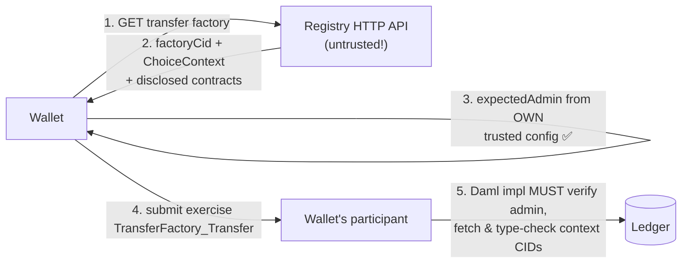

---

### V15. Privacy Over-Sharing

🏠 **IRL:** cc'ing the whole company on a salary negotiation.

Patterns:
- **Observers that are too broad** (e.g. putting a public/operator party as observer on every user contract).
- **Fetching unnecessary contracts** inside choices whose actor shouldn't learn them (Hacken: *fetching unrelated coins divulges them to the actor*).
- **Proposal fields visible to observers**: keep proposals minimal (Hacken).
- **Multi-party agreements**: every listed signatory sees the final terms before anyone commits (Hacken).
- **Batch context leaks**: CertiK says one allocation's private reference data must not leak to another allocation in the same batch.
- **Observer removal**: needs archive + recreate. Revoking a PoA doesn't undo past disclosure.

> 🔍 For each template: list stakeholders. For each choice: list everything fetched/created in its subtree and everyone who will witness it. Ask "need to know?" for each pair.

---

### V16. Contention & Liveness DoS

🏠 **IRL:** one shared office printer for 500 people.

- **Hot contracts:** if every swap consumes the single `Pool` contract, only one swap per commit cycle succeeds and the rest fail with contention. An attacker can **spam** to block others.
- **UTXO contention:** concurrent exercises on the same coin contend. Hacken recommends pre-splitting holdings.
- **Stale contract IDs:** IDs change after every consuming exercise, so cached IDs point to dead contracts.
- **Blocking signatory:** in multi-party agreements one absent signatory blocks finalization (Hacken).
- **Dust:** the runtime never compacts. Wallets should merge.
- **Stranded assets:** a lock with no expiry strands funds if the locker disappears (Hacken).

> 🔍 Which contracts are touched by *every* user action? Can an unprivileged party force repeated archival of a shared contract? Can any party unilaterally block others forever?

---

### V17. Upgrade (SCU) Risks

Smart Contract Upgrade lets packages evolve with backward-compatible changes (e.g. **adding optional fields**). Risks:

- New optional field defaults to `None` for old contracts → **new code treats `None` as "no limit"/"no lock"**.
- Changing `ensure`, signatories or choice semantics in a new version → **old contracts interpreted under new rules**.
- **Package vetting:** which participants have vetted which version? A disclosed v2 contract fails if the submitter's participant lacks v2 models.
- Removing a choice/guard in v2 that old integrations relied on.

> 🔍 Diff v(n) vs v(n+1) like a proxy upgrade review: for each changed template, check what happens to **existing** contracts under new code.

---

### V18. Off-Ledger & Operational Weaknesses

Canton docs and CertiK both stress that the **off-ledger layers** are where apps add gaps:

- **Ledger API auth**: JWTs with overly broad `actAs`/`readAs` rights. CertiK warns about **`CanReadAsAnyParty` "super-readers"**: a leaked credential exposes every party on that participant.
- **PQS, logs, metrics, debug tools** inherit that visibility.
- **Admin API exposure** (party management, package upload) must be firewalled.
- **Keys**: use HSM/KMS. Never on dev machines or CI.
- **Automation/backends** that pick "the first contract" from unsorted queries → OpenZeppelin's *non-deterministic ordering at the application boundary*.
- **Registry API authentication isn't standardized** (CertiK), and contract IDs sometimes act as de facto access tokens in logs.

> 🔍 Map each privilege to the mechanism that enforces it: **Daml controller**, **preapproval**, **Ledger API right**, or **topology permission** (CertiK's checklist item #12).

---

### 📋 Catalogue cheat sheet

| # | Class | One-liner test |
|---|---|---|
| V1 | Unvalidated CID args | "Can I pass a contract from another pool/issuer/owner?" |
| V2 | Caller-set economics | "What if I choose the fee/price/amount?" |
| V3 | Conservation | "Does Σin = Σout on every path?" |
| V4 | Field drift | "Is every field carried over?" |
| V5 | Missing guards | "Does *every* choice check lock/expiry/state?" |
| V6 | Free options | "Can it be cancelled? Does it expire?" |
| V7 | Nonconsuming reuse | "What if I call it 1,000 times?" |
| V8 | Over-broad delegation | "What's the max the delegate can do?" |
| V9 | Flexible controllers | "Who can see it = who can call it?" |
| V10 | Uniqueness | "Can I create two?" |
| V11 | Time | "Too early? Too late? Skewed?" |
| V12 | Arithmetic | "Zero denominator? Rounding to 0?" |
| V13 | Interface MUSTs | "Does the impl check what the spec demands?" |
| V14 | Untrusted context | "Where did this CID/admin come from?" |
| V15 | Privacy | "Does this party need to know?" |
| V16 | Liveness | "Can someone block everyone?" |
| V17 | Upgrades | "What happens to old contracts under new code?" |
| V18 | Off-ledger | "Which credential grants this, and who holds it?" |

---

# PART III: CANTON NETWORK SPECIFICS

---

## 7. Splice, Amulet & Canton Coin

**Splice** ([github.com/canton-network/splice](https://github.com/canton-network/splice)) is the open-source code that runs the Global Synchronizer's economics and apps: **Amulet** (the generic token model behind **Canton Coin, CC**), the DSO governance, validator/SV apps, wallet, and the token standard implementation. On the Canton forum, Digital Asset staff recommend Splice as **the first codebase for a new Daml auditor**, alongside the public **Quantstamp audit of Splice Amulet**.

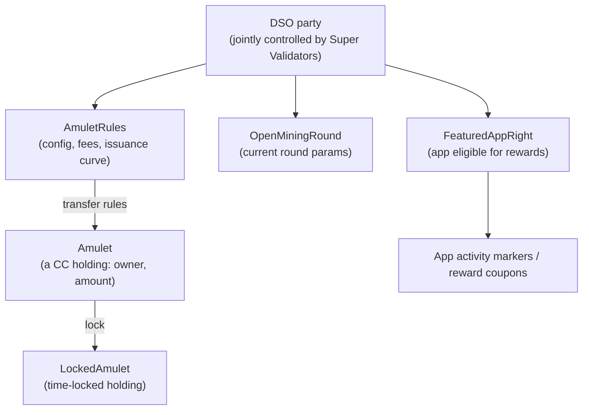

**Things to study in Splice:**
- How `AmuletRules_Transfer` validates inputs (ownership, round, fees) → a reference for **V1/V3**.
- How **explicit disclosure** is used so users can reference DSO-owned contracts (AmuletRules, OpenMiningRound) without being stakeholders.
- **Rounds & time**: issuance and fees are tied to mining rounds → **V11**.
- **Featured app rewards**: apps get CC rewards for activity. Halborn's **HAL-05** (*swap activity is not recorded for featured rewards*) shows that *economic correctness* bugs count too, not just theft.
- **Transfer preapprovals**: let a receiver pre-accept incoming transfers (one-step transfers). Part of the authorization chain!

---

## 8. The Token Standard

### 8.1 CIP-56 in one picture

**CIP-0056** is the Canton Network Token Standard, roughly Canton's ERC-20. It is *a set of Daml interfaces plus off-ledger registry APIs*. **CIP-0112** (Token Standard **V2**, approved June 2026) is a backward-compatible extension. CIP-56 remains the deployed baseline.

Key building blocks:

| Interface/API | Purpose |
|---|---|
| **Holding** | A token balance contract (owner, instrument, amount, lock) |
| **TransferFactory / TransferInstruction** | Offer-accept transfers (two-step unless preapproved) |
| **AllocationFactory / Allocation** | Reserve holdings now for a **third-party settlement** later |
| **AllocationRequest** | An app asks a wallet to allocate |
| **Metadata API** (off-ledger) | Instrument info |
| **Registry HTTP API** (off-ledger) | Gives clients factory CIDs, choice context, disclosed contracts |

**Why offer-accept instead of push transfers?** Regulated assets need **receiver consent** (you can't push securities into someone's account), and compliance checks run *atomically* with the transfer.

### 8.2 DvP: the killer use case

**IRL:** buying a house with escrow. The buyer's money and the seller's deed both go to the escrow agent. The agent swaps them **at the same instant**, or returns both.

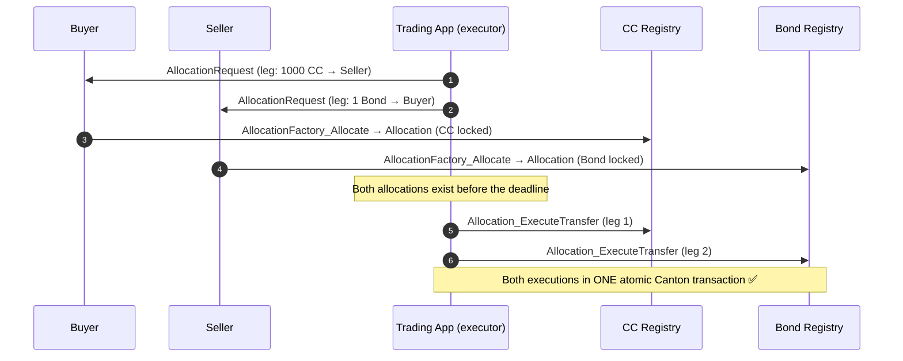

The settlement's **executor**, together with sender and receiver, jointly controls the allocation.

### 8.3 CertiK's 12-point CIP-56 audit checklist (paraphrased)

1. The concrete implementation checks **every interface obligation**, following helper calls.
2. `expectedAdmin` comes from a source **independent** of registry-supplied data.
3. **Type and owner validation** for every contract referenced through choice context.
4. Registry API **authentication**, transport security, and contract-ID handling in logs.
5. `SettlementFactory_SettleBatch` **actors match expected executors**.
6. Allocation-to-settlement **matching** and per-allocation context filtering.
7. Terminal choices (settle/cancel/withdraw are **nonconsuming** at the interface level) → trace that the allocation is **actually consumed**.
8. Check both **early-withdrawal** and **post-deadline settlement** paths.
9. Account configs for unintended **standing authority**.
10. `EventLog` consumers filter by expected instrument admin and account.
11. **Super-reader** credentials and downstream data stores.
12. Map each privilege to its enforcing mechanism.

> 🧠 Notice how these map onto the catalogue: 1→V13, 2–3→V14, 5→V1, 7→V7, 8→V11, 9→V8, 11→V18.

---

# PART IV: DOING THE AUDIT

---

## 9. Audit Methodology

### 9.1 The pipeline

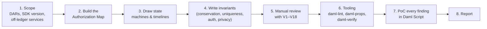

### 9.2 Step 2: the Authorization Map (your most valuable artifact)

Build this table for **every** template before reading any choice body in detail:

| Template | Signatories | Observers | Choice | Kind | Controllers | Authority in body (= ctrl ∪ sig) | Args that matter | Fetches / Exercises |
|---|---|---|---|---|---|---|---|---|
| Iou | issuer, owner | — | Transfer | consuming | owner | issuer, owner | newOwner | — |
| IouTransferProposal | issuer, owner | newOwner | Accept | consuming | newOwner | issuer, owner, newOwner | — | — |
| Pool | operator | users | Redeem | **nonconsuming** | **user (arg)** | operator, user | **lpCid** | fetch LpToken ⚠️ |

Red flags jump out immediately: nonconsuming + flexible controller + CID argument + operator authority = **look here first**.

### 9.3 Step 3: state machines

Draw each workflow:

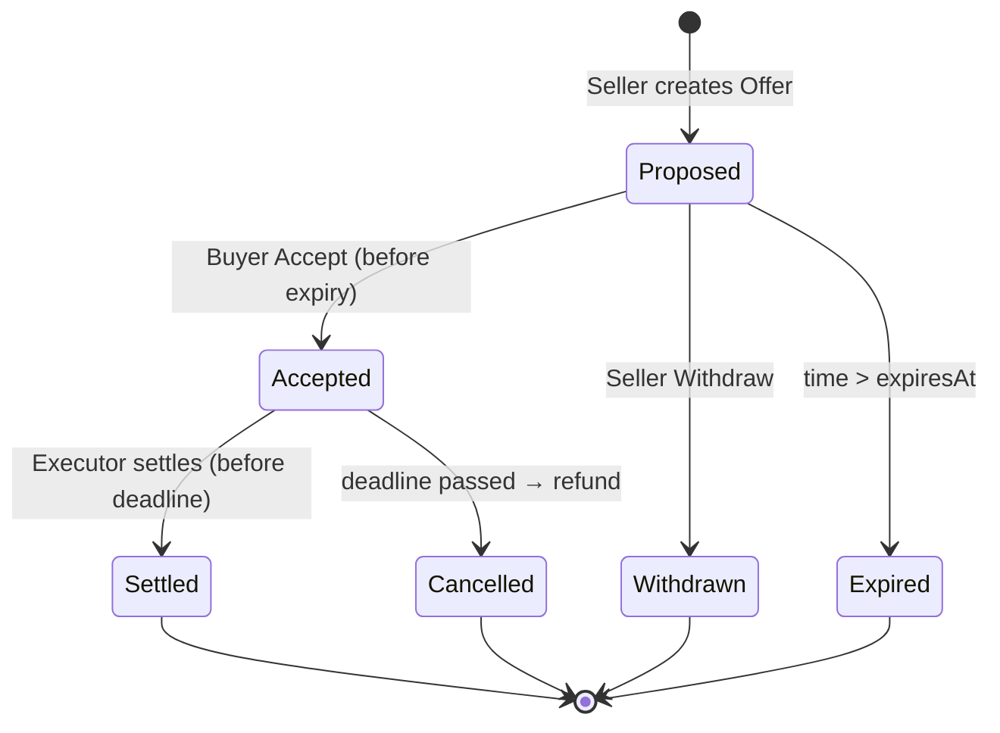

Then ask of every arrow: who can trigger it, under what guard, and is there an arrow the code allows that's **missing from the diagram**?

### 9.4 Step 4: invariants to write down

- **Conservation:** total supply per instrument changes only via mint/burn choices controlled by the issuer.
- **Authorization:** no party's holdings decrease without that party's (direct or pre-agreed) authority.
- **Uniqueness:** at most one active `Pool` per (instrumentA, instrumentB, operator).
- **Liveness:** every locked asset has a path back to its owner after a deadline.
- **Privacy:** party X never witnesses contracts of type Y it isn't a stakeholder of.

### 9.5 Step 6: tooling

| Tool | What it does | Link |
|---|---|---|
| **daml-lint** | Static analyzer written in Rust (OpenZeppelin) | github.com/OpenZeppelin/daml-lint |
| **daml-props** | Property-based testing in Daml | github.com/OpenZeppelin/daml-props |
| **daml-verify** | Formal verification using Z3 | github.com/OpenZeppelin/daml-verify |
| **Daml Script** | Unit/integration tests, your PoC framework | Canton SDK |
| **dpm** | The SDK CLI (replaces the `daml` assistant in 3.x) | docs.canton.network |
| **Daml Studio** (VS Code) | Script results, transaction views | Canton SDK |

### 9.6 Writing a Daml finding

```markdown
## [C-01] LP tokens from any pool can be redeemed against Pool X

**Severity:** Critical
**Location:** `Pool.daml#Redeem` (L42–L58)

**Description:** `Redeem` fetches the `LpToken` passed as `lpCid` but never checks
`lp.poolId == poolId`. Since the choice body runs with `operator` authority, a user
holding LP tokens of a low-value pool can redeem them against a high-value pool.

**Impact:** Drain of any pool's reserves.

**Proof of Concept:** (Daml Script)
**Recommendation:** assert `lp.poolId == poolId`, `lp.operator == operator`, `lp.owner == user`.
```

---

## 10. Case Studies

### 10.1 Halborn × Tradecraft AMM (Dec 2025): a full findings map

Tradecraft is an automated liquidity layer (AMM) on Canton. Halborn's public report lists **12 findings: 2 Critical, 3 Medium, 5 Low, 2 Informational**, all solved. The public page lists titles only. The "class" column is **my mapping to this book's catalogue**, to train your pattern recognition, not Halborn's wording.

| ID | Title (Halborn) | Sev | Catalogue class |
|---|---|---|---|
| HAL-01 | LP token supply can be created or consumed from a different pool | Critical | **V1** unvalidated CID / cross-context |
| HAL-02 | User controlled transfer fee parameter enables unauthorized token overpayment | Critical | **V2** caller-set economics |
| HAL-03 | Allocation execution window is more restrictive than the settlement model | Medium | **V11** time windows |
| HAL-04 | Multiple liquidity pools can be created for the same instrument pair | Medium | **V10** uniqueness |
| HAL-05 | Swap activity is not recorded for featured rewards | Medium | §7 economic/rewards integration |
| HAL-06 | Settlement deadlines allow logically invalid execution windows | Low | **V11** |
| HAL-07 | Zero liquidity pool creation due to decimal quantization | Low | **V12** rounding |
| HAL-08 | Exact Decimal comparisons on computed values | Low | **V12** |
| HAL-09 | Requests and relationships cannot be explicitly revoked once created | Low | **V6** lifecycle/revocation |
| HAL-10 | Fee updates can silently disable swaps | Low | **V12** governance params |
| HAL-11 | Lack of explicit venue and vault consistency checks when creating pool requests | Info | **V1** |
| HAL-12 | Cancellation reason for pool creation requests is not persisted | Info | audit trail |

**Lesson:** *both Criticals are "the code trusted an input it shouldn't have."* In Daml, the protocol nails authorization. **Validation of arguments is still entirely on the developer.**

🧪 **Exercise:** for each Halborn title, write (a) a 10-line vulnerable template that would produce it, and (b) the Script PoC. (This is the best single exercise in the book.)

### 10.2 CertiK × Digital Asset Registry (Aug 2026)

CertiK audited the Digital Asset Registry Daml code (which backs assets like USDCx), including files such as `Rule/Transfer.daml`, `Holding/Unlock.daml` and `Types.daml`. Executive summaries are public on docs.digitalasset.com.
🧪 **Exercise:** read the in-scope files *before* the summary, write your own findings, then compare.

### 10.3 Quantstamp × Splice Amulet

The public audit of Canton Coin / Splice Amulet is the reference for the network's core token.
🧪 **Exercise:** blind-audit `Splice.Amulet`, `Splice.AmuletRules` and `Splice.AmuletAllocation`, then compare with the report.

### 10.4 Why "Daml is safe" is a myth (forum discussion)

On the Canton forum a developer asked whether Daml needs audits "like Solidity". The answer from the ecosystem: yes. *A mistake in the logic could still allow unauthorized actions.* Daml removes reentrancy and overflow, but **business workflow and authorization logic bugs remain** (QuillAudits makes the same point).

---

## 11. The Master Checklist

Copy this into every audit.

### 🔐 Authorization
- [ ] Authorization map built for every template/choice
- [ ] Signatory sets are minimal. No party signs more than it must
- [ ] Every choice's body authority (`controllers ∪ signatories`) reviewed for maximal impact
- [ ] Every flexible controller (`controller <arg>`) has an allow-list/check
- [ ] Every CID argument is fetched **and** all context fields validated (issuer, owner, instrument, pool, settlement)
- [ ] Every economic argument (amount, fee, price, rate) bounded or sourced from trusted config
- [ ] Delegations/PoAs scoped (target, action, expiry) and revocable
- [ ] Authorization contracts are single-use or explicitly reusable by design
- [ ] Interface MUSTs implemented in every `interface instance`

### ♻️ Lifecycle
- [ ] Every `nonconsuming` choice is safe to repeat
- [ ] Every proposal/request has Withdraw/Reject + expiry
- [ ] Every lock has a release path (expiry/clawback)
- [ ] Guard matrix complete (locked/paused/expired/state) for every state-changing choice
- [ ] `create this with ...` used (no field drift)
- [ ] "Only one X" assumptions enforced by design, not by (non-unique) keys
- [ ] Terminal choices actually consume the contract through the call chain

### 💰 Asset logic & math
- [ ] Conservation holds on split/merge/transfer/settle/fee paths
- [ ] Merge checks issuer, owner, instrument, lock state
- [ ] No division by governance-controllable values without `ensure > 0`
- [ ] Rounding direction favours the protocol. No zero-output paths
- [ ] No exact equality on computed Decimals where tolerance is intended
- [ ] Config templates have `ensure` bounds

### ⏰ Time
- [ ] Every deadline enforced on both edges
- [ ] Windows validated at creation (start < end, consistent with settlement model)
- [ ] Ledger-time tolerance considered for every time comparison
- [ ] No cross-synchronizer ordering assumptions

### 👁️ Privacy
- [ ] Observers minimal. Choice observers justified
- [ ] No unnecessary fetches in choices with external actors (divulgence)
- [ ] Batch/multi-leg contexts don't leak across legs
- [ ] Observer removal path exists (archive + recreate)

### 🚦 Liveness
- [ ] No hot singleton contract consumed by every user action (or contention accepted)
- [ ] No single party can block others indefinitely
- [ ] Backends handle stale CIDs and sort query results deterministically

### 🔄 Upgrades
- [ ] SCU diffs reviewed. New optional fields' `None` semantics are safe
- [ ] Old contracts behave correctly under new code
- [ ] Package vetting plan across counterparties

### 🖥️ Off-ledger
- [ ] Ledger API tokens least-privilege. No unnecessary super-readers
- [ ] PQS/log/metrics access controlled
- [ ] Admin API not exposed. Keys in HSM/KMS
- [ ] Registry API authenticated. `expectedAdmin` from a trusted source
- [ ] Choice-context CIDs type/owner-checked on-ledger

---

## 12. Hands-On Labs

> Set up: install the Canton SDK (`dpm`), create a project, and paste each lab into `daml/Lab.daml`. Your goal: **write a Script where the attacker succeeds**, then fix it and make the Script fail.

### 🧪 Lab 1: The Borrowed Ticket (V1)
```haskell
template Ticket
  with venue : Party; holder : Party; event : Text
  where signatory venue; observer holder

template Gate
  with venue : Party; event : Text
  where
    signatory venue
    nonconsuming choice Enter : ()
      with guest : Party; ticketCid : ContractId Ticket
      controller guest
      do
        t <- fetch ticketCid
        assertMsg "holder" (t.holder == guest)
        archive ticketCid
```
**Task:** enter the "Finals" gate with a "Group Stage" ticket.
<details><summary>Hint</summary>Which field of the ticket is never compared with the gate?</details>

### 🧪 Lab 2: The Generous Splitter (V3)
```haskell
template Coin
  with issuer : Party; owner : Party; amount : Decimal
  where
    signatory issuer, owner
    choice Split : (ContractId Coin, ContractId Coin)
      with x : Decimal
      controller owner
      do
        a <- create this with amount = x
        b <- create this with amount = amount - x
        pure (a, b)
```
**Task:** turn 10.0 coins into a contract worth 1,000,000.0.
<details><summary>Hint</summary>What if x is negative? There's no `ensure`.</details>

### 🧪 Lab 3: The Eternal Coupon (V7)
```haskell
template Coupon
  with shop : Party; customer : Party
  where
    signatory shop
    observer customer
    nonconsuming choice Redeem : ContractId Voucher
      controller customer
      do create Voucher with shop; customer; value = 10.0

template Voucher
  with shop : Party; customer : Party; value : Decimal
  where signatory shop; observer customer
```
**Task:** mint 100 vouchers from one coupon. **Fix:** make it consuming.

### 🧪 Lab 4: The Overpowered Attorney (V8)
Write a `PowerOfAttorney` (as in V8) and show the attorney transferring an Iou the principal **didn't intend**. Then scope it.

### 🧪 Lab 5: The Two Pools (V10)
Write a `PoolFactory` with a nonconsuming `CreatePool` choice. Show two pools for the same pair. Then redesign it so the factory tracks pairs in a `Set` and is consumed and recreated.

### 🧪 Lab 6: The Zero Fee Freeze (V12)
Write a `FeeConfig` with `divisor : Decimal` and a `Swap` that divides by it. Show the operator can freeze swaps with `divisor = 0.0`. Fix it with `ensure`.

### 🧪 Lab 7: The Chatty Servicer (V15)
Write a `Loan` with a choice the servicer controls that `fetch`es the borrower's `Kyc` contract. Use Daml Studio's transaction view to confirm the servicer now **witnesses** the KYC data. Redesign to pass only what's needed.

### 🧪 Lab 8: Capstone
Pick a public Daml repo (Splice, or a Canton Quick Start app). Produce: authorization map + 2 state diagrams + at least 3 findings or "no finding, because…" notes + Script PoCs.

---

## 13. Study Plan, Resources & Glossary

### 13.1 Six-week plan

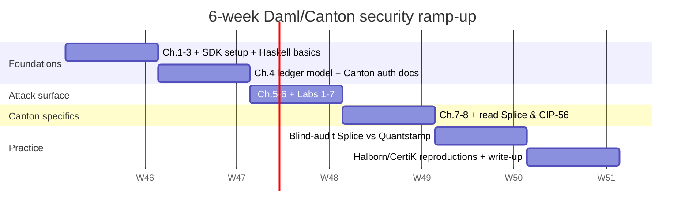

| Week | Goal | Output |
|---|---|---|
| 1 | Read & write basic Daml. Get Haskell syntax comfortable | 3 templates + Scripts |
| 2 | Master authorization & privacy rules | Authorization map of the IOU example |
| 3 | Learn V1–V18 | Labs 1–7 solved |
| 4 | Understand Splice + CIP-56 | Notes + diagrams of Amulet & allocations |
| 5 | Real audit practice | Your own Splice findings vs Quantstamp |
| 6 | Reproduce Halborn titles. Publish | A public blog post / GitHub repo of Daml vuln patterns |

### 13.2 Curated resources (only the best)

**Core docs**
- Canton Network app-dev docs, *Parties and authority*: https://docs.canton.network/appdev/modules/m3-authorization
- Canton docs, *Security Best Practices*: https://docs.canton.network/appdev/modules/m7-security
- CIP-56 reference: https://docs.canton.network/overview/reference/cip-0056
- Smart Contract Upgrades / architecture: https://docs.canton.network/appdev/deep-dives/upgrading-architecture
- What's new in 3.x (keys, SCU, APIs): https://docs.canton.network/docs-main/appdev/get-started/whats-new

**Theory**
- *Daml: A Smart Contract Language for Securely Automating Real-World Multi-Party Business Workflows* (arXiv 2303.03749): https://arxiv.org/pdf/2303.03749

**Security research**
- Hacken, *Daml Design Patterns and Security Analysis*: https://hacken.io/discover/daml-design-patterns-and-security-analysis/
- Hacken, *Auditing Daml Privacy on Canton Network*: https://hacken.io/discover/auditing-daml-privacy-on-canton-network/
- OpenZeppelin, *Smart contract security for institutional finance on Canton*: https://www.openzeppelin.com/news/smart-contract-security-for-institutional-finance-on-canton-an-entirely-different-problem
- CertiK, *Where CIP-56 Security Actually Lives*: https://www.certik.com/blog/where-cip-56-security-actually-lives-a-guide-for-institutions-on-canton

**Code & reports**
- Splice: https://github.com/canton-network/splice
- Canton: https://github.com/digital-asset/canton · Daml: https://github.com/digital-asset/daml
- Quantstamp, Splice Amulet audit (linked from the Canton forum thread below)
- Digital Asset Registry audits (CertiK): https://docs.digitalasset.com/registry/security/audits
- Halborn, Tradecraft AMM: https://www.halborn.com/audits/obsidian/tradecraft-amm-1e29e9
- Halborn, Temple diff review: https://www.halborn.com/audits/temple/daml---diff-review-c3478a

**Tools**
- daml-lint / daml-props / daml-verify: https://github.com/OpenZeppelin

**Community**
- Canton forum, *Security Auditing on Canton*: https://forum.canton.network/t/security-auditing-on-canton/8789
- Canton forum, *Daml smart contracts need auditing like Solidity?*: https://forum.canton.network/t/daml-smart-contracts-need-auditing-like-solidity/8367

### 13.3 Glossary

| Term | Meaning |
|---|---|
| **Actor** | Party exercising a choice (its controllers) |
| **Allocation** | Holdings reserved for a third-party settlement (CIP-56) |
| **Amulet** | Splice's token template, the basis of Canton Coin |
| **Choice observer** | Party who sees a specific exercise and its subtree |
| **Consuming choice** | Archives the contract when exercised |
| **Contract ID (CID)** | Unique ID of a contract instance. Changes on every recreate |
| **DAR** | Compiled Daml package |
| **Divulgence** | Seeing a contract by witnessing a transaction that used it |
| **DSO** | Decentralized Synchronizer Operator party (Super Validators) |
| **DvP** | Delivery versus Payment: atomic asset-for-cash swap |
| **Explicit disclosure** | Using a contract you aren't a stakeholder of by attaching its blob |
| **Informee** | Party informed of an action |
| **Ledger time** | Submitter-proposed time, bounded by tolerance from record time |
| **Mediator** | Synchronizer component that aggregates confirmations |
| **Participant** | Node that hosts parties and runs Daml |
| **PQS** | Participant Query Store (SQL mirror) |
| **Record time** | Time assigned by the sequencer |
| **SCU** | Smart Contract Upgrade |
| **Sequencer** | Orders encrypted messages |
| **Signatory** | Party whose authority creates and binds a contract |
| **Splice** | Open-source Global Synchronizer apps & economics |
| **Stakeholder** | Signatory or observer |
| **Synchronizer** | Ordering and commit infrastructure (formerly "domain") |
| **View** | The part of a transaction a given participant receives |

---

### 🏁 Final words

Every Daml finding you will ever write is one of three sentences:

> 1. **"This party can make something happen that it shouldn't."** (authority / validation)
> 2. **"This party learns something it shouldn't."** (privacy)
> 3. **"This thing can happen twice, too early, too late, never, or block everything."** (lifecycle)

Master the authorization rule in §4.2, build the authorization map in §9.2, and run the 18 questions in §6 against every choice. That's the whole job. Happy hunting, 🍊🛡️
